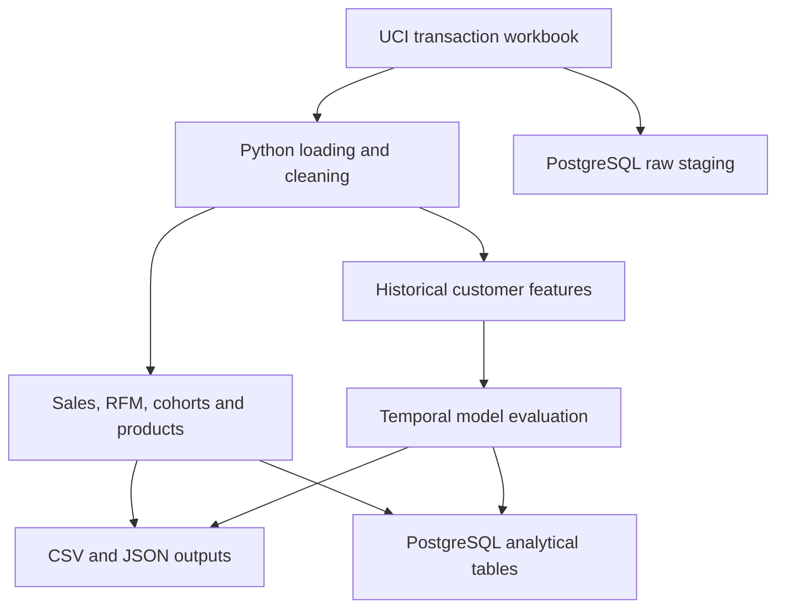

# RetailPulse — Customer Retention & Revenue Intelligence

RetailPulse is a batch analytics and machine-learning project that turns historical retail transactions into revenue insights, customer segments, cohort retention tables, and 90-day repeat-purchase predictions.

Built with **Python, Pandas, NumPy, Scikit-learn, PostgreSQL, SQLAlchemy, and Docker**, using the UCI Online Retail II dataset.

## What it does

- Cleans transaction records and preserves excluded rows for review.
- Calculates monthly gross sales, return credits, net revenue, order counts, and average order value.
- Segments identified purchasing customers using recency, frequency, and monetary value (RFM).
- Measures monthly customer activity by first-observed purchase cohort.
- Analyzes product sales, quantities, and return-credit ratios.
- Compares Logistic Regression and Gradient Boosting against constant-probability and recency baselines.
- Exports analytical tables and evaluation files, with optional PostgreSQL loading.

## Architecture



`pipeline.py` performs the main cleaning, analytics, feature engineering, and evaluation. PostgreSQL stores the raw and analytical tables; the SQL queries provide independent analysis and reconciliation. Database loading runs when `DATABASE_URL` is set. This version runs as a batch command.

## Measured results

The results below are from the completed local macOS run. Python processing and PostgreSQL loading completed, and the SQL analysis reconciled revenue totals. Library versions can affect model results; use the evaluation files generated by your own run when reproducing the project.

| Data and revenue metric | Result |
|---|---:|
| Raw transaction lines | 1,067,371 |
| Retained transaction lines | 1,027,016 |
| Excluded transaction lines | 40,355 |
| Identified purchasing customers | 5,878 |
| Customers with multiple purchase invoices across the historical window | 72.4% |
| Gross sales | £20,476,260.43 |
| Return credits | £1,462,424.18 |
| Net revenue | £19,013,836.25 |

Net revenue equals gross sales minus return credits. It is not profit.

### Repeat-purchase evaluation

The target is whether an existing customer makes at least one valid purchase during the 90 days following a snapshot. Features use only transactions before that snapshot.

| Stage | Snapshot date | Purpose |
|---|---|---|
| Training | 12 March 2011 | Fit models |
| Validation | 11 June 2011 | Select the model using average precision |
| Test | 10 September 2011 | Evaluate on a later period |

Gradient Boosting was selected on validation average precision. The test contained **5,281 customers**, of whom **43.4%** purchased within the following 90 days.

| Test metric | Result |
|---|---:|
| Gradient Boosting average precision (AP) | 0.761 |
| Recency baseline AP | 0.686 |
| Absolute AP improvement over recency | 0.075 |
| ROC-AUC | 0.787 |
| Brier score | 0.197 |
| Precision among the highest-scored 10% | 91.9% |
| Predictive lift among the highest-scored 10% | 2.12× |

The ten features describe recency, tenure, order count, gross spending, average order value, distinct products, recent orders over 30 and 90 days, recent spending over 90 days, and historical return-line count.

Evaluation also includes a fixed 0.5-threshold classification assessment, a calibration table, and a paired bootstrap confidence interval for the AP difference versus recency. Exact values are in `outputs/evaluation.json`.

AP is a ranking metric, not accuracy. Predictive lift measures how concentrated repeat purchasers are in the selected group; no campaign revenue uplift was measured. Customers can appear across snapshots, so this evaluates later behavior for existing customers. One final test period and one historical retailer limit generalization. Final customer scores are historical, not present-day forecasts.

## Run on macOS

Install Python 3.11 or newer. For database loading, also install and start Docker Desktop.

From the project folder:

```bash
python3 -m venv .venv
source .venv/bin/activate
python -m pip install -r requirements.txt
python -m unittest discover -s tests -v
mkdir -p data
curl -L --fail \
  https://archive.ics.uci.edu/static/public/502/online+retail+ii.zip \
  -o data/uci.zip
python pipeline.py --input data/uci.zip
```

The pipeline reads both workbook sheets. An extracted XLSX path can also be passed to `--input`. Use Online Retail II, which covers two years.

For analytics without model training:

```bash
python pipeline.py --input data/uci.zip --analytics-only
```

To explicitly run without database loading:

```bash
python pipeline.py --input data/uci.zip --database-url ''
```

Each run regenerates files in `outputs/`. Analytics-only runs remove previous model outputs. Keep notes and manually edited files outside this directory, and run only one pipeline process at a time.

## PostgreSQL setup

Create the environment file once:

```bash
cp .env.example .env
```

Set `POSTGRES_PASSWORD` in `.env`. Do not copy the example over an already configured file.

The supplied `compose.yaml` maps host port 5432 to PostgreSQL's internal port 5432. If that host port is occupied, change the mapping to an available port, for example:

```yaml
ports:
  - "127.0.0.1:55432:5432"
```

Start the database:

```bash
docker compose up -d --wait
docker compose ps
```

With the example port mapping above, set the connection URL through a password prompt:

```bash
export DATABASE_URL="$(python - <<'PY'
from getpass import getpass
from sqlalchemy import URL

url = URL.create(
    'postgresql+psycopg2',
    username='retailpulse',
    password=getpass('Database password: '),
    host='127.0.0.1',
    port=55432,
    database='retailpulse',
)
print(url.render_as_string(hide_password=False))
PY
)"
```

Enter the database password. If you keep the original host mapping, use `port=5432` instead. Test authentication before running the pipeline:

```bash
python - <<'PY'
import os
from sqlalchemy import create_engine, text

engine = create_engine(os.environ['DATABASE_URL'])
with engine.connect() as connection:
    print('Connected to:', connection.execute(
        text('SELECT current_database()')
    ).scalar())
engine.dispose()
PY
```

Expected: `Connected to: retailpulse`.

Then load the data:

```bash
python pipeline.py --input data/uci.zip
```

The pipeline reloads staging and analytical tables in the project's `retailpulse` schema inside one database transaction. Keep unrelated data outside that schema. An initialized Docker volume retains its original database password; editing `.env` alone does not change it. Activate the virtual environment and set `DATABASE_URL` separately in each new terminal.

### Verify the database

```bash
docker compose exec -T postgres \
  psql -U retailpulse -d retailpulse \
  -c "SELECT 'raw_transactions' AS dataset, COUNT(*) FROM retailpulse.stg_transactions
      UNION ALL
      SELECT 'clean_transactions', COUNT(*) FROM retailpulse.fct_transactions
      UNION ALL
      SELECT 'customers', COUNT(*) FROM retailpulse.dim_customers
      UNION ALL
      SELECT 'prediction_scores', COUNT(*) FROM retailpulse.customer_scores;"
```

Expected counts for a full run: **1,067,371**, **1,027,016**, **5,878**, and **5,878**, respectively.

Run the SQL analysis:

```bash
docker compose exec -T postgres \
  psql -U retailpulse -d retailpulse < sql/analysis.sql
```

## Data-quality and metric decisions

- Exact duplicates across the eight business fields are removed; invoice and product identifiers alone are insufficient for deduplication.
- Missing or invalid customer IDs remain anonymous. Valid anonymous transactions contribute to revenue and product analysis, but not customer segmentation or prediction.
- Valid negative-quantity transactions remain as return credits. Invalid records and positive-quantity cancellation-prefixed records are quarantined.
- Orders count distinct purchase invoices, preventing multi-line invoices from inflating order counts.
- RFM monetary value uses gross purchase spending. Segments are descriptive rules, not learned clusters.
- Cohorts use the first observed purchase month. Unobserved future months are not treated as zero retention; the final calendar month is conservatively censored.
- Known return-only customers may appear in transaction facts without a customer-dimension entry. Reconcile total revenue without filtering through the purchaser-only customer dimension.

See [data policy](docs/DATA_POLICY.md) and [evaluation methodology](docs/EVALUATION.md) for definitions and limitations.

## Project files

| File or directory | Responsibility |
|---|---|
| `pipeline.py` | Cleaning, analytics, ML evaluation, exports, and database loading |
| `requirements.txt` | Python dependencies |
| `compose.yaml` | PostgreSQL container configuration |
| `.env.example` | Database configuration template |
| `sql/schema.sql` | Database tables and constraints |
| `sql/analysis.sql` | Data-quality diagnostics and business analysis queries |
| `docs/DATA_POLICY.md` | Cleaning rules and metric definitions |
| `docs/EVALUATION.md` | Temporal evaluation, baselines, and limitations |
| `tests/test_pipeline.py` | Data accounting, leakage, horizon, identity, and cohort checks |
| `outputs/` | Generated analytical tables and evaluation artifacts |

Key outputs include `data_quality.json`, `excluded_rows.csv`, `monthly_sales.csv`, `cohort_retention.csv`, `product_performance.csv`, `customer_scores.csv`, `evaluation.json`, `test_predictions.csv`, `calibration.csv`, and `RESULTS.md`.

## Reproducibility and GitHub

After a run, record the environment outside the generated output folder:

```bash
python --version > environment.txt
python -m pip freeze >> environment.txt
```

Keep credentials, `.env`, virtual environments, raw data, generated row-level outputs, and temporary files out of Git. Commit source code, dependency definitions, tests, SQL, documentation, and reviewed aggregate results. Review customer-level data before publishing it.

## Dataset attribution

Source: [UCI Online Retail II](https://archive.ics.uci.edu/dataset/502/online+retail+ii), Daqing Chen. DOI: [10.24432/C5CG6D](https://doi.org/10.24432/C5CG6D). Dataset license: CC BY 4.0.
